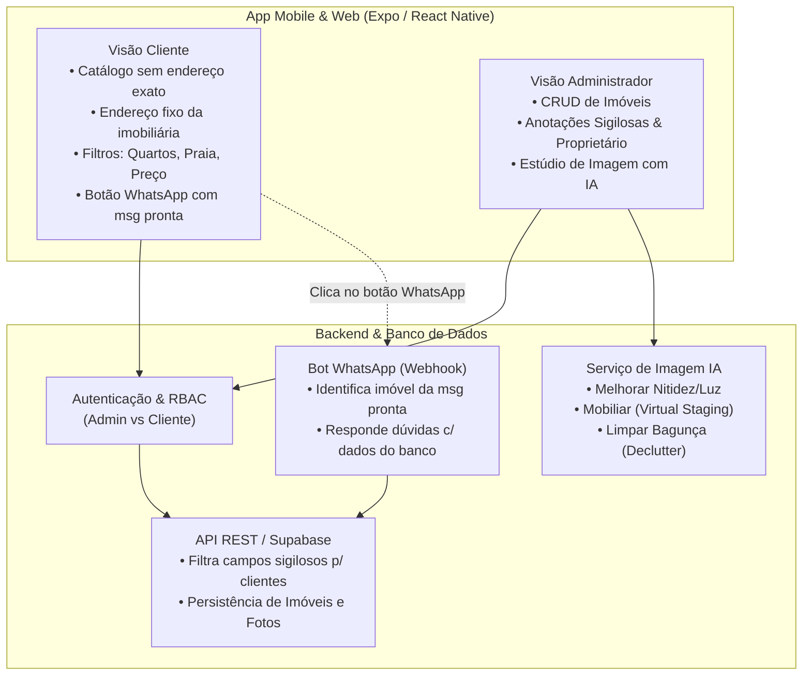

# Plano de Implementação — Corretoras de Sucesso Imóveis

Este documento detalha o planejamento técnico completo para transformar o aplicativo **Corretoras de Sucesso Imóveis** em uma plataforma completa com **visão de Cliente e Administrador**, **Backend com controle de permissões**, **Integração e Automação de WhatsApp** e **Melhoria de Imagens com IA**.

---

## 1. Mapeamento dos Apontamentos da Reunião

| # | Requisito da Reunião | Situação Atual no Projeto | O que será feito |
|---|---|---|---|
| 1 | **Nome na tela de início: "Corretoras de Sucesso Imóveis"** | Exibe apenas `"Corretoras de Sucesso"` em [`SplashScreen.tsx`](./src/screens/SplashScreen.tsx) e [`Header.tsx`](./src/components/Header.tsx). | Atualizar a Splash Screen e o Header principal para **"Corretoras de Sucesso Imóveis"**. |
| 2 | **App para Clientes + Versão de Administrador (com Backend)** | App 100% local (`useState`) onde qualquer pessoa edita/exclui imóveis. | Criar **Backend + Autenticação com papéis (`admin` e `client`)**. Clientes apenas visualizam, filtram, favoritam e entram em contato; Admins cadastram, editam, excluem e usam IA. |
| 3 | **Card/Tabela do Imóvel: status, tipo, valor, SEM endereço exato** | [`PropertyCard.tsx`](./src/components/PropertyCard.tsx) não exibe badge de status e usa `location` livre. | Exibir badge **"Disponível" / "Reservado"**, tipo (Apartamento, Casa, etc.), preço, quartos, distância da praia e apenas **Bairro/Cidade** (nunca o endereço exato para o cliente). |
| 4 | **Campo fixo em cada imóvel com o endereço da imobiliária** | Não existe. | Adicionar constante institucional fixa com o **Endereço da Imobiliária** exibida em todos os imóveis ([`PropertyCard.tsx`](./src/components/PropertyCard.tsx) e [`PropertyDetailModal.tsx`](./src/screens/PropertyDetailModal.tsx)). |
| 5 | **Anotações visíveis APENAS para Admins** | [`NotesList.tsx`](./src/components/ui/NotesList.tsx) aparece para todos em [`PropertyDetailModal.tsx`](./src/screens/PropertyDetailModal.tsx) (expondo telefone do proprietário). | Ocultar `notes` e `ownerContact` na interface de clientes **e** filtrar esses campos na API do backend quando o usuário não for `admin`. |
| 6 | **Remover estatísticas dos imóveis** | Existe [`StatisticsScreen.tsx`](./src/screens/StatisticsScreen.tsx), `PieChart.tsx`, `SalesLineChart.tsx` e aba no [`BottomNav.tsx`](./src/components/BottomNav.tsx). | Remover a tela de estatísticas, gráficos e o botão correspondente na barra inferior, deixando a navegação limpa (`Início`, `Favoritos` e `Conta/Admin`). |
| 7 | **Adicionar distância da praia aos imóveis** | Não existe no modelo [`Property`](./src/types/property.ts). | Adicionar `beachDistance: number` (em metros, ex: `0` = Frente Mar / Pé na areia, `200` = 200m da praia) no banco, tipos, cards, detalhes e formulário. |
| 8 | **Busca por nº de quartos, distância da praia e faixa de preço** | Busca avançada tem muitos campos misturados e não tem distância da praia. | Criar **filtros diretos e rápidos** por **Quartos**, **Distância da Praia** e **Faixa de Preço** na [`HomeScreen.tsx`](./src/screens/HomeScreen.tsx) e simplificar o [`AdvancedSearchModal.tsx`](./src/screens/AdvancedSearchModal.tsx) (removendo busca por anotações para clientes). |
| 9 | **Mensagem pronta para WhatsApp identificando o imóvel** | Não existe botão de WhatsApp. | Adicionar botão **"Falar com Corretora no WhatsApp"** no imóvel que abre o link `wa.me` com mensagem pré-preenchida contendo **Código, Nome, Tipo, Bairro e Valor do imóvel**. |
| 10 | **Responder dúvidas via WhatsApp automaticamente** | Não existe. | Implementar webhook no backend (integrável com **Z-API / Evolution API / WhatsApp Cloud API**) que lê o código do imóvel na mensagem do cliente, consulta o banco de dados e responde automaticamente dúvidas sobre preço, condomínio, quartos, distância da praia e agendamento. |
| 11 | **Melhora de imagens com IA (Melhorar, Mobiliar, Tirar Bagunça)** | Apenas upload simples da galeria em [`PropertyFormModal.tsx`](./src/screens/PropertyFormModal.tsx). | Adicionar **Estúdio IA para Admins** no cadastro/edição do imóvel com 3 ações: **1. Melhorar Qualidade/Luz**, **2. Mobiliar Imóvel (Virtual Staging)** e **3. Remover Bagunça (Declutter)**, com comparativo Antes/Depois. |

---

## 2. Arquitetura Proposta (Frontend + Backend + IA + WhatsApp)



### Opções de Backend
1. **Opção A — Supabase (BaaS PostgreSQL + Auth + Storage) + API Node.js/Python auxiliar para IA e WhatsApp (Recomendado):**
   - Já possui **Autenticação pronta** (e-mail/senha com role `admin` ou `client`), **Banco PostgreSQL em nuvem** (funciona no celular de qualquer pessoa da faculdade sem precisar estar na mesma rede Wi-Fi) e **Storage de imagens** para salvar as fotos originais e geradas por IA.
2. **Opção B — Backend próprio em Node.js (Express/Fastify) ou Python (FastAPI) + SQLite/PostgreSQL + JWT:**
   - Servidor REST próprio dentro de uma pasta `backend/` no projeto com rotas `/auth/login`, `/auth/register`, `/properties` (retornando `notes` só se o token JWT for `admin`), `/ai/enhance-image` e `/webhook/whatsapp`.

---

## 3. Novo Modelo de Dados do Imóvel

Atualização em [`src/types/property.ts`](./src/types/property.ts):

```typescript
export type UserRole = 'admin' | 'client';

export interface User {
  id: string;
  name: string;
  email: string;
  role: UserRole;
}

export interface Property {
  id: string;
  code: string; // Ex: "AP-101" para identificar facilmente no WhatsApp
  name: string;
  type: 'Apartamento' | 'Casa' | 'Cobertura' | 'Terreno' | 'Outros';
  neighborhood: string; // Bairro/Cidade (público, SEM endereço exato)
  agencyAddress: string; // Campo fixo com o endereço da imobiliária
  beachDistance: number; // Distância da praia em metros (0 = Frente mar)
  area: number; // m²
  price: number; // R$
  condominium?: number; // R$
  iptu?: number; // R$
  bedrooms: number;
  bathrooms: number;
  parkingSpaces?: number;
  status: 'Disponível' | 'Vendido' | 'Reservado';
  imageUrl: string;
  originalImageUrl?: string; // Guardado caso a imagem tenha sido melhorada por IA
  isFavorite?: boolean;

  // Campos EXCLUSIVOS de Admin (omitidos para clientes)
  notes?: string[];
  ownerContact?: string;
  exactAddressInternal?: string; // Caso a corretora queira anotar a rua/número só para o admin
}
```

---

## 4. Detalhamento das Fases de Implementação

### Fase 1: Identidade Visual, Remoção de Estatísticas e Adequação do Modelo de Imóvel
- **Tela Inicial e Cabeçalho:**
  - Alterar [`SplashScreen.tsx`](./src/screens/SplashScreen.tsx) e [`Header.tsx`](./src/components/Header.tsx) para exibir **"Corretoras de Sucesso Imóveis"**.
- **Remoção de Estatísticas:**
  - Remover [`StatisticsScreen.tsx`](./src/screens/StatisticsScreen.tsx), [`PieChart.tsx`](./src/components/PieChart.tsx), [`SalesLineChart.tsx`](./src/components/SalesLineChart.tsx) e [`usePropertyStatistics.ts`](./src/hooks/usePropertyStatistics.ts).
  - Atualizar [`BottomNav.tsx`](./src/components/BottomNav.tsx) para exibir:
    - Aba **Imóveis (Home)**
    - Botão **`+` (Adicionar Imóvel)** -> *Visível apenas quando logado como `admin`*
    - Aba **Favoritos**
    - Aba **Perfil / Login (Alternar ou Logar como Admin/Cliente)**
- **Card e Detalhes do Imóvel:**
  - Exibir claramente: **Status (Disponível)**, **Tipo (Apartamento/Casa/etc.)**, **Valor em R$**, **Quartos**, **Distância da praia (ex: `150m da praia` ou `Frente Mar`)** e **Bairro** (sem rua/número do imóvel).
  - Exibir **Campo Fixo do Endereço da Imobiliária** em todos os imóveis.

### Fase 2: Busca por Quartos, Distância da Praia e Faixa de Preço
- Atualizar [`usePropertyFilters.ts`](./src/hooks/usePropertyFilters.ts) e [`AdvancedSearchModal.tsx`](./src/screens/AdvancedSearchModal.tsx):
  - Adicionar filtro de **Distância máxima da praia** (ex: `Frente mar (0m)`, `Até 200m`, `Até 500m`, `Até 1km`, `Qualquer`).
  - Destacar os 3 filtros principais na tela inicial e no modal de busca:
    1. **Número de Quartos** (1+, 2+, 3+, 4+)
    2. **Distância da Praia**
    3. **Faixa de Preço (Mínimo e Máximo)**
  - Ocultar a busca por palavras-chave em `notes` para usuários comuns (`client`), mantendo-a apenas para `admin`.

### Fase 3: Backend, Autenticação e Controle de Acesso (Admin vs. Cliente)
- Criar o sistema de autenticação (`AuthContext` + tela/modal de Login e Cadastro):
  - **Cliente:** Pode navegar no catálogo, usar filtros, favoritar imóveis e chamar no WhatsApp. Não vê `notes`, não vê contato do proprietário, não vê botões de criar/editar/excluir.
  - **Administrador (Corretora):** Faz login com credencial de admin; vê e edita as **Anotações Confidenciais (`notes`)** em cada imóvel, cadastra novos imóveis, edita preços/status e utiliza a ferramenta de IA nas fotos.

### Fase 4: Botão de WhatsApp com Mensagem Pronta + Resposta Automática (Bot)
- **No App (`PropertyDetailModal.tsx` e `PropertyCard.tsx`):**
  - Botão verde **"Tenho Interesse via WhatsApp"** para os clientes.
  - Ao clicar, abre o WhatsApp da corretora com a mensagem pronta:
    > *"Olá! Vi no app Corretoras de Sucesso Imóveis o imóvel **[AP-01] Apartamento Frente Mar Guilhermina** (Apartamento • R$ 950.000 • 50m da praia) e gostaria de mais informações!"*
- **Automação de Respostas no WhatsApp:**
  - **Integração via Z-API / Evolution API / WhatsApp Cloud API:** Um webhook no backend recebe a mensagem do WhatsApp, identifica o código `[AP-01]` ou usa IA (Gemini/OpenAI) conectada à lista de imóveis do banco para responder na hora dúvidas do cliente (valor de condomínio, IPTU, quartos, distância da praia, endereço da imobiliária para visita).
  - **Modo Simulador / Assistente Integrado:** Também disponível para demonstração ao vivo na apresentação da faculdade.

### Fase 5: Melhoria de Imagens com IA (Diferencial Competitivo)
- No [`PropertyFormModal.tsx`](./src/screens/PropertyFormModal.tsx) (exclusivo para Admin), abaixo da foto selecionada, adicionar o painel **"Melhorar Foto com IA ✨"** com 3 botões de transformação:
  1. **✨ Melhorar Iluminação e Nitidez:** Corrige fotos escuras ou de baixa qualidade.
  2. **🛋️ Mobiliar Imóvel (Virtual Staging):** Adiciona móveis modernos em cômodos vazios mantendo a estrutura do ambiente.
  3. **🧹 Tirar Bagunça (Declutter):** Remove objetos espalhados, fios ou bagunça em cima de mesas/pias para deixar a foto limpa e profissional.
- Fluxo: O Admin escolhe a foto -> clica em uma das 3 opções -> o backend processa a imagem via API de IA -> o app exibe um comparador **"Original vs. Melhorada com IA"** -> o Admin confirma se quer usar a versão gerada.
